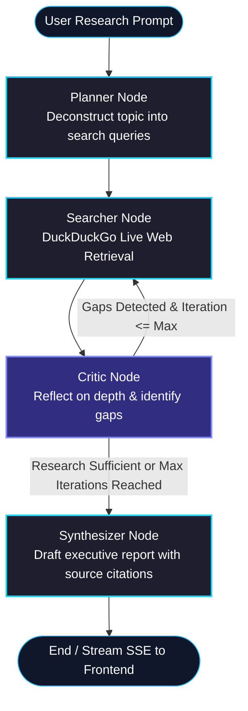

# 🧭 DeepResearcher

> **Autonomous Multi-Step Evidence Retrieval & Synthesis Agent**  
> Built with **LangGraph**, **Google Gemini 2.5 Flash**, **DuckDuckGo Search**, **FastAPI SSE**, and **React + Vite**.  
> **100% Free Tier Tooling** with **Single-Platform Monolithic Deployment** and **Pluggable LLM Providers**.

---

## 🌟 Overview

**DeepResearcher** is an agentic AI system designed to solve complex research questions that single-prompt chatbots or basic RAG systems cannot adequately address.

Instead of answering immediately with potentially hallucinated or outdated information, the agent:
1. **Deconstructs** any research prompt into focused, multi-perspective search queries (**Planner Node**).
2. **Executes live web searches** across DuckDuckGo without requiring paid API keys (**Searcher Node**).
3. **Reflects & evaluates** gathered evidence for knowledge gaps, conflicting findings, or insufficient depth (**Critic Node**).
4. **Iterates autonomously** with targeted follow-up queries if gaps are detected (Cyclic LangGraph State Machine).
5. **Synthesizes** an executive-ready Markdown dossier complete with verified source citations, trade-off comparisons, and structured tables (**Synthesizer Node**).

---

## 🏗️ Architecture & Agent Graph



---

## ✨ Key Architectural Highlights

- **Single-Platform Unified Deployment:** Render hosts both the FastAPI backend and the compiled React SPA from a single service and domain. Zero CORS configuration and one single URL to share.
- **Pluggable LLM Provider Factory:** Switch between **Google Gemini**, **Groq** (free Llama 3.3 70B), or **Hugging Face** / OpenRouter by simply toggling `LLM_PROVIDER` in `.env` — with **zero code modifications**.
- **Autonomous Cyclic Reflection:** Employs a cyclic LangGraph state machine with recursion guards (`max_iterations = 2`) preventing infinite loops while ensuring deep coverage.
- **100% Free-Tier Tooling:** Powered by Google's free Gemini 2.5 Flash API tier (1,500 requests/day) and DuckDuckGo (`ddgs`) search. Zero credit card or paid search subscriptions required.
- **Real-Time Event Streaming (SSE):** FastAPI streams live agent thoughts, queries, scraped sources, reflection critique, and the final dossier to the UI via Server-Sent Events.
- **Shared Access Key Barrier:** Protected by an `APP_ACCESS_KEY` (`X-App-Key` header / Basic Auth on `/docs`) to prevent unauthorized usage when deployed publicly.
- **Local History Persistence:** Completed research dossiers and citations are automatically stored in the browser's `localStorage` for offline reference and instant recall.

---

## 🛠️ Tech Stack

| Layer | Technologies |
|---|---|
| **Agent Core** | Python 3.11, **LangGraph**, **LangChain Google GenAI** (`gemini-2.5-flash`), **DDGS** (DuckDuckGo) |
| **Pluggable Providers** | Google Gemini (`gemini-2.5-flash`), Groq (`llama-3.3-70b`), Hugging Face Serverless |
| **Backend API** | **FastAPI**, **Uvicorn**, Server-Sent Events (`StreamingResponse`), Pydantic Settings |
| **Frontend UI** | **React 18**, **Vite 5**, **Lucide Icons**, **React-Markdown**, **Remark-GFM** |
| **Styling** | Cybernetic Dark Theme with CSS Variables & Responsive Dual-Column Grid |
| **Deployment** | **Render Single Web Service** (Serves both API and compiled React SPA) |

---

## 🚀 Quick Start (Local Development)

### 1. Prerequisites
- **Python 3.11+** installed
- **Node.js 18+** & npm installed
- A free **Google Gemini API Key** from [Google AI Studio](https://aistudio.google.com/)

### 2. Run Backend & Frontend in Development Mode

**Terminal 1 (Backend):**
```bash
cd backend
# With virtual environment activated:
uvicorn app.main:app --reload --port 8000
```
*Health check at `http://127.0.0.1:8000/health`. Swagger UI at `http://127.0.0.1:8000/docs` (Passcode: `researcher2026`).*

**Terminal 2 (Frontend with Hot-Reload):**
```bash
cd frontend
npm run dev
```
*Open `http://localhost:5173`.*

---

## 🔄 Switching LLM Providers (Zero Code Changes)

DeepResearcher includes a built-in provider factory (`app/agent/llm_factory.py`). To switch models, change the environment variables in `.env` (or Render dashboard):

### Option 1: Google Gemini (Default)
```bash
LLM_PROVIDER="gemini"
GEMINI_API_KEY="your-gemini-key"
GEMINI_MODEL="gemini-2.5-flash"
```

### Option 2: Groq Cloud (Free Llama 3.3 70B)
```bash
LLM_PROVIDER="groq"
GROQ_API_KEY="your-groq-api-key"
GROQ_MODEL="llama-3.3-70b-versatile"
```

### Option 3: Hugging Face / OpenRouter / OpenAI
```bash
LLM_PROVIDER="custom"
CUSTOM_LLM_API_KEY="your-token"
CUSTOM_LLM_MODEL="meta-llama/Llama-3.1-8B-Instruct"
CUSTOM_LLM_BASE_URL="https://api-inference.huggingface.co/v1"
```

---

## 📦 Single-Platform Deployment (Render Only)

1. Push this repository to GitHub.
2. Go to [Render Dashboard](https://dashboard.render.com/) -> **New** -> **Web Service**.
3. Connect your repository.
4. Set the following settings:
   - **Environment:** `Python 3`
   - **Build Command:**
     ```bash
     cd frontend && npm install && npm run build && cd .. && pip install -r requirements.txt
     ```
   - **Start Command:**
     ```bash
     cd backend && uvicorn app.main:app --host 0.0.0.0 --port $PORT
     ```
5. Add Environment Variables:
   - `GEMINI_API_KEY`: `<your-gemini-api-key>`
   - `APP_ACCESS_KEY`: `<your-chosen-passcode>` (e.g. `researcher2026`)
   - `LLM_PROVIDER`: `gemini`
6. Click **Deploy Web Service**. Render will build the React frontend, install backend requirements, and serve your entire app from a single URL!

---

## 📄 License
MIT License. Built for advanced agentic AI experimentation and portfolio demonstration.
